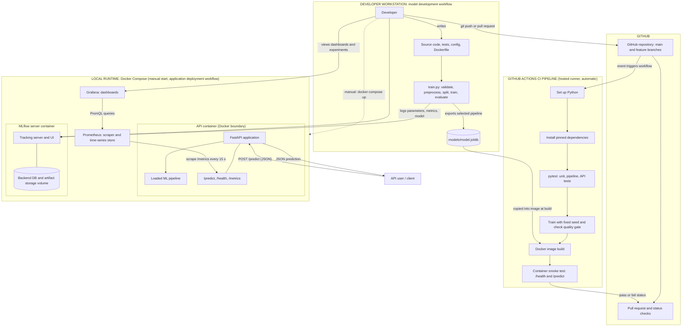
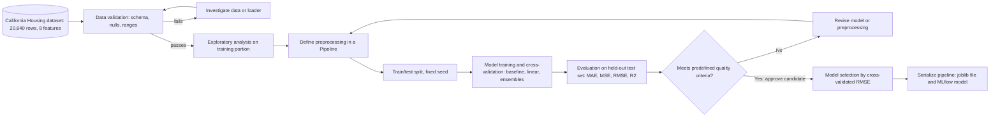
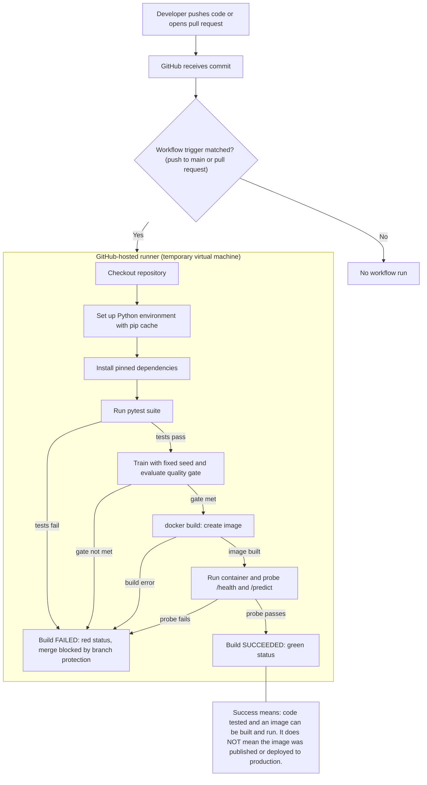
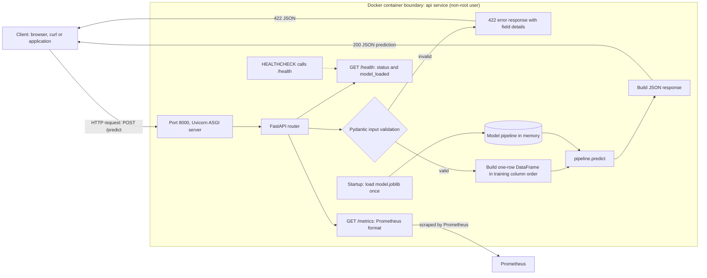
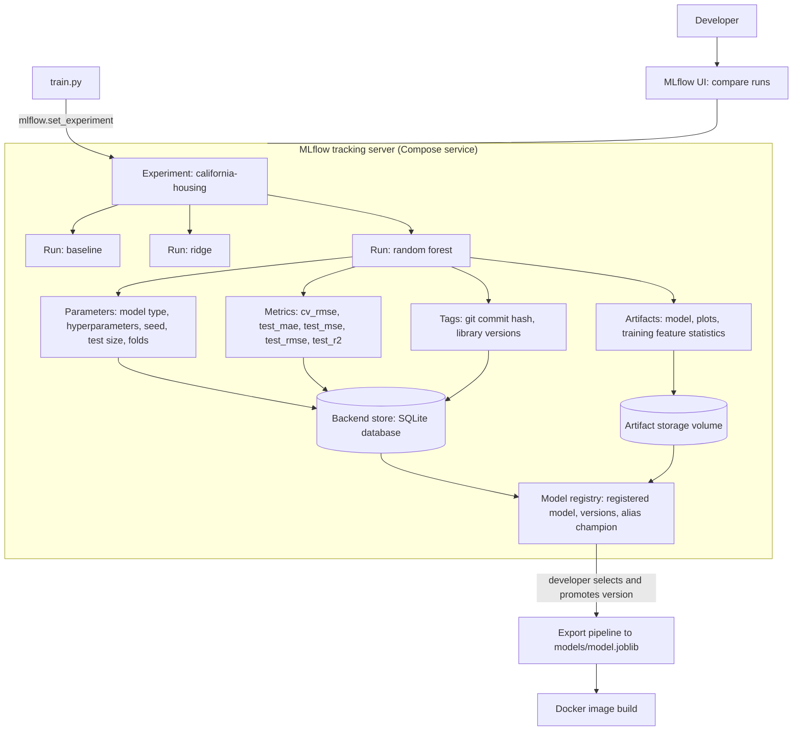
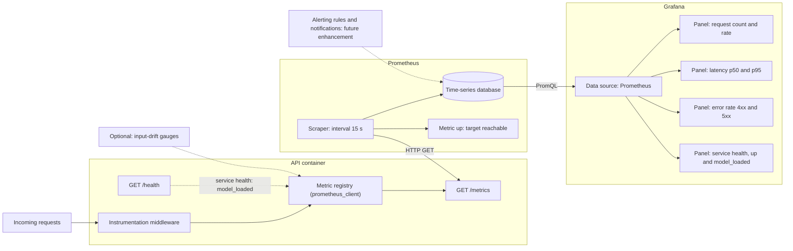
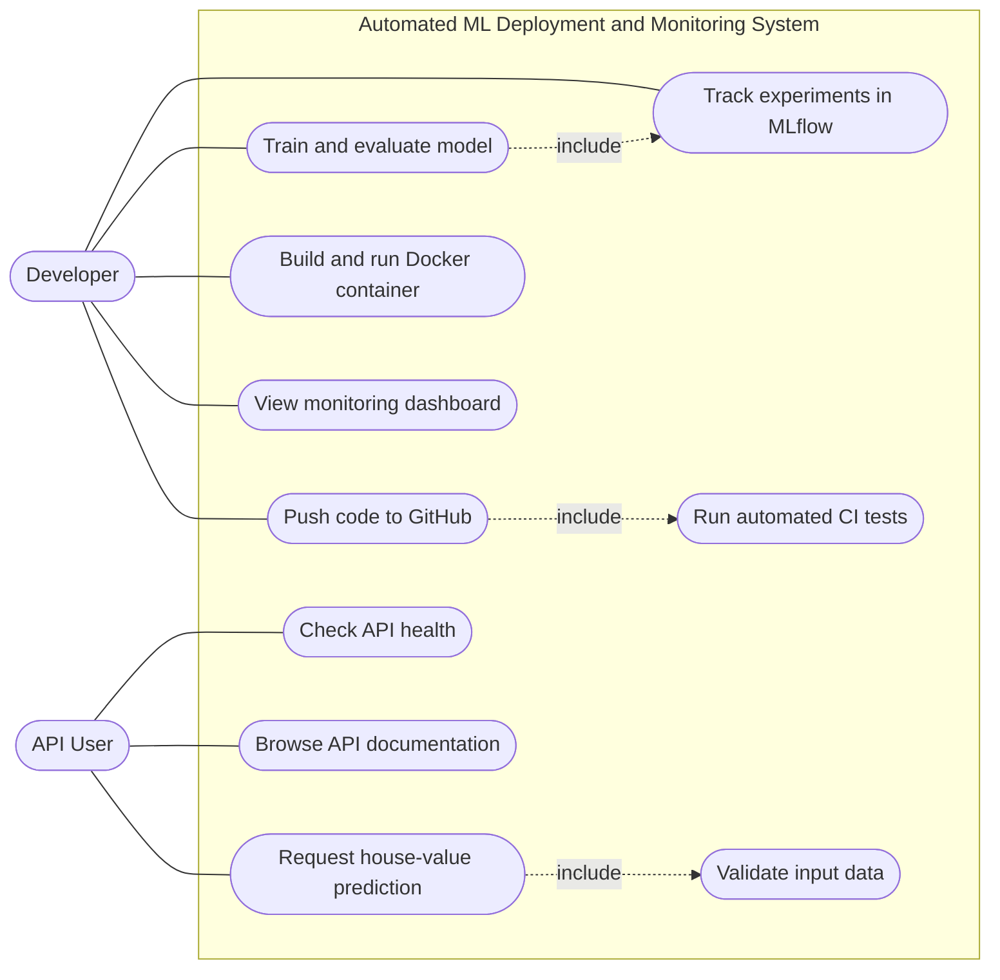
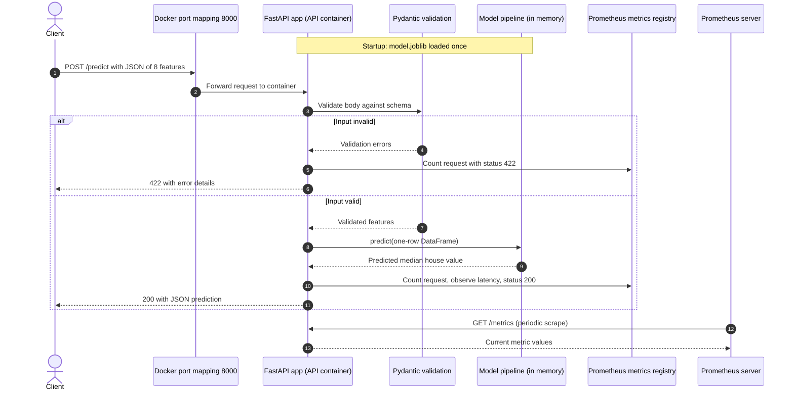
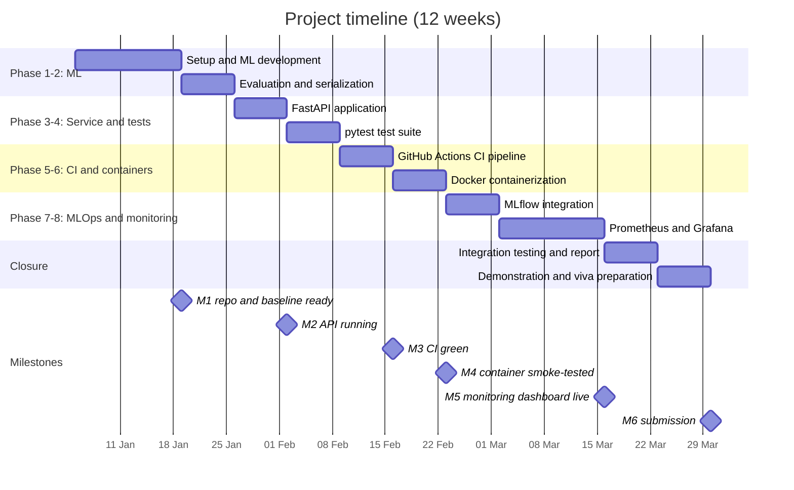

  

# PROJECT PROPOSAL

 

## Automated Machine Learning Deployment and Monitoring System

*A DevOps and MLOps pipeline for developing, testing, containerizing, serving and monitoring a machine learning application*

 

---

| | |
|:--|:--|
| **Student name** | `[Haseeb Tariq]`, `[Sharjeel Ikhlaq]`, `[Moaz Naeem]` |
| **Registration number** | `[58957]`, `[58129]`, `[55286]` |
| **Program** | `[BS-IT]` |
| **Department** | `[Information Technology]` |
| **University** | `[Riphah International University]` |
| **Course** | DevOps |
| **Instructor / Supervisor** | `[Dr. Asif Nauman]` |
| **Submission date** | `[DD MONTH YYYY]` |

---

 

*Status: proposal. All features are **Planned** unless explicitly marked otherwise. No experimental results are reported.*

## Contents

A. Cover Page · B. Abstract · C. Introduction and Background · D. Problem Statement · E. Proposed Solution · F. Objectives · G. Scope · H. Technology Stack · **System Architecture (Diagrams 1–8)** · Implementation Methodology (Phases 1–8) · I. Functional Requirements · J. Non-Functional Requirements · K. Expected Results and Deliverables · L. Timeline · M. Risks and Mitigation · N. Future Enhancements · O. Conclusion · References · Consistency Check

**Terminology used throughout.** *Continuous Integration (CI)* is automated build and test on every change. *Deployment* means running the application in a runtime environment; in this project it is performed **manually** with Docker Compose on a local machine. *Delivery to production* is out of scope. *Application monitoring* observes the service (requests, latency, errors); *model monitoring* observes prediction quality and input drift and is only partially addressed.

**Status labels.** **Planned** = mandatory, not yet built. **Optional** = attempted if time permits. **Future enhancement** = outside current scope.

---

## B. Abstract

Machine learning models are frequently developed in notebooks and shared as saved files, which leaves testing, environment management, deployment and monitoring to manual, undocumented steps. This project proposes an **Automated Machine Learning Deployment and Monitoring System** that applies DevOps practice to the full life of a small ML application. A scikit-learn regression model is trained on the California Housing dataset to predict median house value, its experiments are recorded in **MLflow**, and the selected model is exposed through a validated **FastAPI** REST service. Source code is versioned in **Git/GitHub**; every push triggers a **GitHub Actions** workflow that installs pinned dependencies, runs **pytest** tests, enforces a model quality gate, builds a **Docker** image and smoke-tests the resulting container. The service exposes metrics that **Prometheus** collects and **Grafana** visualises as request-rate, latency, error-rate and health dashboards.

DevOps supplies the delivery mechanics: version control, automated testing, reproducible environments, containers and observability. MLOps adds what ML specifically needs: experiment tracking, model versioning, quality gates based on evaluation metrics, and awareness that data and models, not only code, change. The expected outcome is a reproducible, tested, containerised prediction service with experiment records and a monitoring dashboard, developed incrementally on a single student workstation. Continuous deployment to production, Kubernetes and automated retraining are explicitly excluded and listed as future work.

---

## C. Introduction and Background

### C.1 From experimentation to production

ML experimentation optimises for **learning**: trying features, algorithms and hyperparameters quickly, usually in a notebook on one machine. Production-style deployment optimises for **reliability**: the same behaviour on any machine, controlled change, observable failures. A model that scores well in a notebook is not yet an application. It needs an interface other programs can call, input validation, a pinned runtime, automated tests, and a way to see whether it is working after it starts.

### C.2 Problems of manual testing and deployment

| Manual practice | Resulting problem |
|---|---|
| Running tests "when remembered" | Defects reach the main branch |
| Installing libraries by hand | Version drift; "works on my machine" |
| Copying a model file to another machine | No traceability of which code and data produced it |
| Recording experiments in filenames or notes | Results cannot be compared or reproduced |
| Checking the service by trying it | Failures noticed by users first |

### C.3 Why automation, reproducibility, containerization and monitoring matter

- **Automation** makes quality checks run every time, not only when someone remembers.
- **Reproducibility** (fixed seeds, pinned dependencies, recorded parameters) lets results be re-created and defended.
- **Containerization** packages code, interpreter and libraries so behaviour is identical across machines.
- **Monitoring** turns a running service from a black box into something whose health, speed and error rate can be measured.

### C.4 Relevance of DevOps to ML systems

ML applications are software and inherit all software risks. They add further sources of change: data, model artifacts and hyperparameters. DevOps practices (version control, CI, containers, observability) are therefore the necessary base on which MLOps practices (experiment tracking, model registry, drift monitoring) are built. This project implements that base and the first MLOps layer on it.

---

## D. Problem Statement

**Engineering problem.** *How can a machine learning application be developed, validated, packaged, executed and observed through an automated and repeatable workflow, so that every change to code or model is tested, every experiment is traceable, and the running service is measurable?*

**Why training and saving a model is insufficient.** A serialised model file does not provide: an API contract and input validation; evidence that code changes did not break behaviour; an identical runtime elsewhere; a record of which parameters, data split and code produced it; criteria deciding whether it is good enough to use; or any information about the service after it starts.

| # | Problem | Addressed by |
|---|---|---|
| P1 | Manual software testing | pytest suite executed by GitHub Actions on every push and pull request |
| P2 | Inconsistent execution environments | Pinned dependencies and a Docker image |
| P3 | Difficult ML model deployment | Containerised FastAPI service started with Docker Compose |
| P4 | No automated quality checks | CI workflow plus model quality gates on evaluation metrics |
| P5 | Limited visibility into application performance | Prometheus metrics and Grafana dashboards |
| P6 | Difficulty tracking experiments and model versions | MLflow tracking and model registry |

---

## E. Proposed Solution

### E.1 Workflow

The system consists of two connected workflows.

**Model development workflow (on the developer workstation):**

1. **Develop and train:** load California Housing, preprocess inside a scikit-learn `Pipeline`, train candidate regressors.
2. **Evaluate:** compute MAE, MSE, RMSE, R² on held-out data and cross-validation scores; apply quality gates.
3. **Store and manage artifacts:** log parameters, metrics and the model to **MLflow**; register the selected version; export the pipeline as `models/model.joblib`.

**Application delivery and runtime workflow:**

4. **Expose predictions:** a FastAPI service loads the model once and serves `POST /predict` and `GET /health`.
5. **Automated tests:** a push to GitHub triggers GitHub Actions, which runs pytest (unit, pipeline and API tests).
6. **Build and run containers:** CI trains with a fixed seed, checks the quality gate, builds the Docker image and smoke-tests the running container. The developer runs the stack locally with Docker Compose.
7. **Track experiments:** MLflow stores run history for comparison and model versions.
8. **Collect metrics:** the API publishes `/metrics`; Prometheus scrapes it.
9. **Visualise:** Grafana queries Prometheus and displays dashboards.

### E.2 How the components relate

Git/GitHub is the **source of truth** and the trigger for CI. CI protects the repository by proving that code, model and image still work. MLflow is the **memory of the model development process**. The trained model is the **payload** carried into the Docker image. FastAPI is the **interface** to that payload. Prometheus and Grafana form the **feedback channel** from the running service back to the developer. Each tool exists because another component depends on its output, and none is included without a requirement that needs it.

---

## F. Objectives

### F.1 Primary objectives

| ID | Objective | Measurable success indicator |
|---|---|---|
| O1 | Automate test execution on code changes | CI runs on every push to `main` and every pull request; failing tests produce a failed status |
| O2 | Provide a containerised prediction service | `docker compose up` starts the API; `/health` returns 200; `/predict` returns a numeric prediction |
| O3 | Implement automated API testing | Tests cover valid input, each invalid-input class, health and metrics endpoints |
| O4 | Record model experiment parameters and metrics | Every candidate run appears in MLflow with parameters, metrics and artifacts |
| O5 | Expose application health and performance metrics | `/metrics` publishes request count, latency histogram and error counters; Prometheus target reports *up* |
| O6 | Establish a repeatable model deployment workflow | A documented, scripted sequence takes a clean checkout to a running stack |

### F.2 Secondary objectives

- Enforce an evaluation-based **model quality gate** in CI.
- Maintain a requirements-to-test traceability table.
- Provide a version-controlled Grafana dashboard definition.
- *(Optional)* Simple input-drift indicator; publish image to GitHub Container Registry.

No performance improvement is claimed in advance; success is judged by the indicators above after implementation.

---

## G. Scope of the Project

| Category | Item | Status |
|---|---|---|
| **Mandatory scope** | California Housing dataset | Planned |
| | Scikit-learn regression model with preprocessing and evaluation | Planned |
| | FastAPI prediction service | Planned |
| | GitHub version control | Planned |
| | GitHub Actions CI pipeline | Planned |
| | pytest automated tests | Planned |
| | Docker containerization (image, Compose stack) | Planned |
| | MLflow experiment tracking | Planned |
| | Prometheus and Grafana monitoring | Planned |
| **Optional** | Simple input-drift check; image push to registry; linting | Optional |
| **Out of scope (initial)** | Kubernetes; complex cloud-native infrastructure; distributed training; large language models; expensive cloud services; enterprise orchestration | Excluded |
| **Future enhancements only** | Cloud deployment, automated retraining, DVC, Kubernetes, PyTorch models, advanced drift monitoring | Future |

**Boundary clarification.** Mandatory "deployment" means running the containerised stack locally. There is no automatic push to a server.

---

## H. Proposed Technology Stack

| Technology | Purpose | How it is used in this project | Justification |
|---|---|---|---|
| Python | Main language | Training, API, tests, scripts | Standard ML language; all other tools have Python support |
| NumPy, Pandas | Data processing | Arrays, `DataFrame` for EDA and for building model input rows | Required by scikit-learn; clear tabular handling |
| Scikit-learn | Model development | Dataset loader, `Pipeline`, regressors, metrics, cross-validation | Consistent API; pipelines prevent leakage and travel with the model |
| Git, GitHub | Version control, collaboration | Repository, branches, pull requests, CI trigger | Industry standard; provides traceability and review |
| GitHub Actions | CI and workflow automation | YAML workflow: install, test, train, gate, build, smoke-test | Native to GitHub; free tier suitable; workflow stored with code |
| pytest | Automated testing | Unit, pipeline, API and quality-gate tests | Concise, fixtures, parametrisation |
| FastAPI | Model serving via REST | `/predict`, `/health`, `/metrics`, OpenAPI docs | Pydantic validation and automatic documentation |
| Docker | Containerization | Image for the API; Compose for the multi-service stack | Reproducible runtime; same artifact in CI and locally |
| MLflow | Experiment tracking and model management | Log parameters, metrics, artifacts; register model versions | Makes experiments comparable and models traceable |
| Prometheus | Metrics collection | Scrapes API `/metrics`; stores time series | Simple pull model; PromQL for rates and percentiles |
| Grafana | Dashboards | Panels for traffic, latency, errors, health | Visualises Prometheus without custom front-end code |

**Why this stack suits a student project with MLOps relevance.** Every tool is open source, runs on one laptop, and has official documentation. Together they mirror the stages of a real ML delivery pipeline (code → test → package → serve → observe, with tracking alongside) without requiring cloud accounts, clusters or cost. Skills gained transfer directly to production tooling.

---

## 3. System Architecture

All eight diagrams describe **one** architecture. Component names are used consistently: *developer workstation*, *GitHub repository*, *GitHub Actions CI pipeline*, *API container*, *MLflow server*, *Prometheus*, *Grafana*.

### Diagram 1: Overall System Architecture

*Caption: Figure 1. Overall architecture showing the model development workflow (workstation, MLflow), the automated CI pipeline, and the manually started Docker Compose runtime with monitoring.*

**Explanation.**

- **Model development workflow.** The developer writes code and runs `train.py`, which validates data, preprocesses, trains and evaluates candidates, **logs every run to the MLflow server**, and exports the selected pipeline to `models/model.joblib`.
- **CI pipeline.** `git push` or a pull request on GitHub triggers GitHub Actions. The runner sets up Python, installs dependencies, runs tests, retrains with a fixed seed and checks the quality gate, builds the Docker image (copying in the model) and smoke-tests the container. Its only output is a **pass/fail status** returned to the pull request. It does **not** deploy anything.
- **Application deployment workflow.** The developer starts the runtime stack **manually** (dotted arrow) with Docker Compose. The API container serves predictions; Prometheus scrapes its `/metrics`; Grafana visualises Prometheus data.
- **Boundaries.** Subgraphs separate who performs each step: the developer (workstation), GitHub-hosted automation (CI), and the local runtime. There is no arrow from CI to the runtime, by design.

### Diagram 2: Machine Learning Development Pipeline

*Caption: Figure 2. Machine learning development pipeline with data validation and a quality-gate decision loop.*

**Explanation.** Splitting happens before any learned statistic is computed, and all preprocessing lives in the `Pipeline`, so each cross-validation fold refits it on its own training portion and **data leakage is prevented**. The test set is used for final evaluation only, never for tuning. The quality criteria (for example, R² above a mean-prediction baseline and RMSE below a threshold) are defined **after** a first baseline experiment and stored in configuration; they are not invented in advance. A failed gate loops back to revision, a passed gate approves the candidate, which is then selected and serialised.

### Diagram 3: CI Pipeline Architecture

*Caption: Figure 3. GitHub Actions workflow, from push to build success or failure.*

**Explanation.** The trigger is defined in the workflow file. Every stage depends on the previous one and any failure ends the run with a failed status. **Docker image build is a verification step**: it proves the code and model can be packaged and that the container starts and answers requests. Publishing the image to a registry is *Optional*, and deploying it to a server is a *Future enhancement*, so a green build is not production deployment.

### Diagram 4: Containerized Application Architecture

*Caption: Figure 4. Request handling inside the API container, including validation, model loading and the health-check endpoint.*

**Explanation.** The model is loaded **once at start-up** and kept in memory. Invalid requests are rejected before reaching the model. If the model cannot be loaded, `/health` reports `model_loaded: false` and `/predict` returns 503. The `HEALTHCHECK` uses `/health` so Docker can report container health. `/metrics` is the integration point with Prometheus.

### Diagram 5: Experiment Tracking Architecture

*Caption: Figure 5. MLflow records experiment names, parameters, metrics, artifacts and model versions, and feeds the promoted model into the image build.*

**Explanation.** Each candidate is a separate run in one experiment, so runs are comparable. Run metadata goes to a SQLite backend (required for the registry); large files go to artifact storage. The developer compares runs in the UI, registers the chosen model as a version and marks it with an alias. Promotion is **manual by design**. The API does not query MLflow at runtime; it serves the exported file, so serving continues if MLflow is stopped.

### Diagram 6: Monitoring Architecture

*Caption: Figure 6. Application monitoring path from API instrumentation to Grafana panels.*

**Explanation.** Middleware increments counters and records latency in histograms. Prometheus **pulls** from `/metrics` and stores the series; Grafana queries them with PromQL. Panels cover request counts, latency percentiles, error rates and service health. This path is **application monitoring**. Drift gauges are optional; alerting and true model-performance monitoring (which needs ground-truth labels) are future enhancements.

### Diagram 7: UML Use Case Diagram

Mermaid has no native UML use-case type; the diagram follows UML conventions with a flowchart (actors outside the system boundary, use cases as ovals).

*Caption: Figure 7. Use cases for the developer and the API user.*

**Explanation.** The developer drives change (training, pushing, building, observing). The API user only consumes the service. Training *includes* experiment tracking, a push *includes* the CI run, and every prediction *includes* input validation.

### Diagram 8: UML Sequence Diagram

*Caption: Figure 8. Sequence of a prediction request through the containerised application, including metric recording.*

**Explanation.** Validation precedes inference. Both outcomes are counted so error rates are measurable. Prometheus's scrape is independent of client requests and occurs on a timer. Latency observed covers handling inside the API process.

---

## 4. Implementation Methodology

Development is **incremental**: each phase produces a working, testable increment and ends with a completion check before the next begins. Work follows Git feature branches merged through pull requests. All phases are **Planned**.

### Phase 1: Project Setup and ML Development

| Item | Description |
|---|---|
| Activities | Create repository, folder structure, virtual environment and pinned `requirements.txt`; load the dataset; perform EDA; build the preprocessing `Pipeline`; train a mean baseline, linear model and tree ensembles |
| Tools | Python, NumPy, Pandas, scikit-learn, Git, Jupyter |
| Expected output | `src/` modules and `train.py` that trains candidates; EDA notebook |
| Completion criteria | `python -m src.train` runs end to end from a clean environment; split uses a fixed seed; no test-set information is used during fitting |

### Phase 2: Model Evaluation and Serialization

| Item | Description |
|---|---|
| Activities | Compute MAE, MSE, RMSE, R² on held-out data; run 5-fold cross-validation on the training set; define quality gates after a baseline run; select a model; serialise the pipeline |
| Tools | scikit-learn metrics and cross-validation, joblib |
| Expected output | `models/model.joblib`; `config/quality_gate.yaml`; evaluation report |
| Completion criteria | Serialised model reloads and reproduces predictions on a fixed sample; selection rule documented before final comparison |

### Phase 3: FastAPI Application Development

| Item | Description |
|---|---|
| Activities | Define Pydantic schemas; load the model at start-up; implement `/predict`, `/health`, error handling; enable OpenAPI documentation |
| Tools | FastAPI, Uvicorn, Pydantic |
| Expected output | Runnable API with Swagger UI |
| Completion criteria | Valid requests return predictions; invalid requests return 422; missing model yields 503 and `model_loaded: false` |

### Phase 4: Automated Testing with pytest

| Item | Description |
|---|---|
| Activities | Write unit tests (data, split, pipeline), model-quality tests, API tests with the FastAPI test client; measure coverage |
| Tools | pytest, pytest-cov, httpx |
| Expected output | `tests/` directory and coverage report |
| Completion criteria | All tests pass locally and are repeatable; every functional requirement has at least one test (traceability table complete) |

### Phase 5: CI Pipeline Using GitHub Actions

| Item | Description |
|---|---|
| Activities | Write `.github/workflows/ci.yml`: checkout, Python setup, dependency install, tests, training and quality gate; enable branch protection on `main` |
| Tools | GitHub Actions, GitHub branch protection |
| Expected output | Automated workflow with visible status checks |
| Completion criteria | Green run on a correct change; **red run demonstrated** on a deliberately broken test; pull requests show status |

### Phase 6: Docker Containerization

| Item | Description |
|---|---|
| Activities | Write `Dockerfile` (slim base, non-root user, healthcheck) and `.dockerignore`; add image build and container smoke test to CI; create `docker-compose.yml` for the API |
| Tools | Docker, Docker Compose |
| Expected output | Image `ml-api` and a Compose file |
| Completion criteria | Image builds locally and in CI; container answers `/health` and `/predict`; runs as non-root |

### Phase 7: MLflow Integration

| Item | Description |
|---|---|
| Activities | Add MLflow server (SQLite backend, artifact volume) to Compose; log parameters, metrics, tags and artifacts for every candidate; register and alias the selected model |
| Tools | MLflow |
| Expected output | Experiment `california-housing` with comparable runs; registered model version |
| Completion criteria | All candidate runs visible in the UI with parameters, metrics and artifacts; the served model can be traced to a run and Git commit |

### Phase 8: Prometheus and Grafana Monitoring

| Item | Description |
|---|---|
| Activities | Instrument the API (counters, histogram, gauges); write `prometheus.yml`; add Prometheus and Grafana to Compose; provision data source and dashboard JSON; generate sample traffic; *(optional)* drift gauges |
| Tools | prometheus_client, Prometheus, Grafana |
| Expected output | Working dashboard with request rate, latency percentiles, error rate and health |
| Completion criteria | Prometheus target is *up*; panels change in response to generated traffic; dashboard definition stored in the repository |

---

## I. Functional Requirements

| ID | Requirement | Priority | Status |
|---|---|---|---|
| FR-01 | The system shall load the California Housing dataset. | Mandatory | Planned |
| FR-02 | The system shall preprocess input data using a pipeline fitted on training data only. | Mandatory | Planned |
| FR-03 | The system shall train and evaluate ML models using MAE, MSE, RMSE and R². | Mandatory | Planned |
| FR-04 | The system shall expose a prediction API (`POST /predict`) with input validation. | Mandatory | Planned |
| FR-05 | The CI pipeline shall execute tests on code changes (push and pull request). | Mandatory | Planned |
| FR-06 | The application shall run in a Docker container with a health-check endpoint. | Mandatory | Planned |
| FR-07 | MLflow shall track experiment parameters, metrics, artifacts and model versions. | Mandatory | Planned |
| FR-08 | Prometheus shall collect application metrics from the API. | Mandatory | Planned |
| FR-09 | Grafana shall display request, latency, error and health information. | Mandatory | Planned |
| FR-10 | The CI pipeline shall enforce a model quality gate and build and smoke-test the Docker image. | Mandatory | Planned |
| FR-11 | The system shall serialise the selected pipeline and load it at API start-up. | Mandatory | Planned |
| FR-12 | The system shall provide a scripted procedure to start the full stack from a clean checkout. | Mandatory | Planned |
| FR-13 | The system shall expose input-drift indicators. | Optional | Optional |

---

## J. Non-Functional Requirements

| Attribute | Requirement | How it is addressed |
|---|---|---|
| Reliability | The API shall stay available when the model cannot be loaded and report this state; internal errors shall not crash the service | Health endpoint, 503/500 handlers, Docker restart policy |
| Maintainability | Code shall be modular (data, training, serving, metrics) with docstrings and type hints | Defined repository layout; pull-request workflow |
| Reproducibility | Same code, data and seed shall yield the same metrics; environments are identical | Fixed seeds, pinned dependencies, Docker image, MLflow parameter and commit logging |
| Portability | The stack shall run on any machine with Docker | Containerisation and Compose |
| Testability | Core logic shall be automatically testable; coverage target suggested at 70 % | pytest suite, CI |
| Security | No secrets in the repository; validated input; non-root container; safe model loading | `.gitignore`, `.env.example`, Pydantic, Dockerfile `USER`; model files only from this pipeline |
| Performance | Predictions shall be fast for single-row requests; latency shall be measurable | Model held in memory; latency histogram. *Numeric targets will be set after measurement* |
| Scalability | Initial design is single-host; no horizontal scaling claimed | Stateless API enables future scaling; orchestration is a future enhancement |

---

## K. Expected Results and Deliverables

| ID | Deliverable | Description |
|---|---|---|
| D1 | Working ML training pipeline | Reproducible `train.py` with preprocessing, cross-validation and evaluation |
| D2 | Trained model artifact | Serialised pipeline and registered MLflow model version |
| D3 | Prediction API | FastAPI service with `/predict`, `/health`, `/metrics`, OpenAPI docs |
| D4 | Automated CI workflow | GitHub Actions workflow with tests, quality gate, image build, smoke test |
| D5 | Docker image and Compose stack | Dockerfile, `docker-compose.yml`, run instructions |
| D6 | MLflow experiment records | Runs comparing candidate models with parameters, metrics, artifacts |
| D7 | Monitoring dashboards | Prometheus configuration and Grafana dashboard definition |
| D8 | Test suite and traceability | pytest tests mapped to FR/NFR |
| D9 | Technical documentation | README, architecture documentation, final report |

**Expected results (not yet achieved).** A repository whose every change is tested automatically; a container that serves validated predictions; experiment history from which the served model can be traced; and a dashboard that reflects live API behaviour. Model accuracy figures will be reported only after experiments are executed and recorded.

---

## L. Project Timeline

12 weeks. Dates are placeholders; replace with the academic calendar.

| Weeks | Phase | Milestone | Deliverable |
|---|---|---|---|
| 1–2 | 1 Setup and ML development | M1: baseline pipeline runs | D1 (part) |
| 3 | 2 Evaluation and serialization | Model exported | D2 (part) |
| 4 | 3 FastAPI | M2: API running | D3 |
| 5 | 4 pytest | Tests passing | D8 |
| 6 | 5 CI | M3: CI green and red-case shown | D4 |
| 7 | 6 Docker | M4: container smoke-tested | D5 |
| 8 | 7 MLflow | Runs and registry in place | D6, D2 |
| 9–10 | 8 Monitoring | M5: dashboard live | D7 |
| 11 | Integration and documentation | Acceptance checks done | D9 |
| 12 | Demonstration | M6: submission | All |

The schedule contains slack by treating the drift check, registry polish and image publishing as optional.

---

## M. Risks and Mitigation

| ID | Risk | Likelihood | Impact | Mitigation |
|---|---|---|---|---|
| R1 | Data quality issues (outliers, capped target values, download failure) | Medium | Medium | EDA and validation step; document limits; retry or cache dataset in CI |
| R2 | Model underperformance | Medium | Medium | Compare against baseline; try several model families; quality gate threshold set after a baseline run; project goal is the pipeline, not record accuracy |
| R3 | Dependency conflicts | Medium | Medium | Pin versions early; one Python version for local, CI and Docker |
| R4 | Docker configuration errors | Medium | High | Test Docker in Phase 1; small incremental Dockerfile; use `.dockerignore`; read container logs |
| R5 | CI workflow failures | High | Medium | Run the same commands locally first; use a throwaway branch; keep workflow short |
| R6 | Monitoring integration issues (networking, labels) | Medium | Medium | Use Compose service names; verify `/metrics` manually, then the Prometheus target, then Grafana |
| R7 | Limited hardware resources | Medium | Medium | Keep models small; limit tree count and depth; run only needed services; no GPU needed |
| R8 | Scope creep | Medium | High | Fixed scope table; extras only as future work |
| R9 | Time shortage | Medium | High | Core path first; optional features last |
| R10 | Misleading claims | Low | High | Status labels; report only measured results |

---

## N. Future Enhancements

All items below are **Future enhancements** and are **not** part of this project's implementation.

| Enhancement | Description |
|---|---|
| Automated model retraining | Scheduled or drift-triggered workflow that trains, compares with the current model and proposes promotion |
| Data versioning with DVC | Track dataset versions alongside code and model |
| Cloud deployment | Run the container on a managed service with HTTPS |
| Container registries | Publish versioned images (for example to GitHub Container Registry) |
| Kubernetes | Orchestrate and scale the API |
| PyTorch-based model support | Add a deep learning model behind the same API and MLflow tracking |
| Advanced drift and performance monitoring | Statistical drift detection, true-value feedback endpoint, alerting rules |

---

## O. Conclusion

This proposal defines a single, coherent engineering system rather than a collection of tools. A tracked and evaluated scikit-learn model is packaged into a validated FastAPI service, tested and built automatically by GitHub Actions, run in Docker, and observed through Prometheus and Grafana. Its central DevOps contribution is to make every change verifiable: code is tested on every push, the model must pass explicit quality gates, the image must build and answer requests, and the running service exposes the metrics needed to judge its health. Its MLOps relevance lies in experiment tracking, model versioning and recognition of the difference between application monitoring and model monitoring. By stating scope boundaries honestly (CI, not production deployment; planned, not completed) the proposal remains achievable on student hardware while building skills directly applicable to production-oriented ML engineering.

---

## References

[1] Python Software Foundation, "Python 3 Documentation." [Online]. Available: https://docs.python.org/3/

[2] scikit-learn developers, "scikit-learn User Guide." [Online]. Available: https://scikit-learn.org/stable/

[3] scikit-learn developers, "Common pitfalls and recommended practices." [Online]. Available: https://scikit-learn.org/stable/common_pitfalls.html

[4] scikit-learn developers, "Cross-validation: evaluating estimator performance." [Online]. Available: https://scikit-learn.org/stable/modules/cross_validation.html

[5] scikit-learn developers, "Metrics and scoring: quantifying the quality of predictions." [Online]. Available: https://scikit-learn.org/stable/modules/model_evaluation.html

[6] GitHub, "GitHub Actions documentation." [Online]. Available: https://docs.github.com/en/actions

[7] pytest Development Team, "pytest documentation." [Online]. Available: https://docs.pytest.org/

[8] Docker Inc., "Docker Documentation." [Online]. Available: https://docs.docker.com/

[9] S. Ramírez, "FastAPI Documentation." [Online]. Available: https://fastapi.tiangolo.com/

[10] MLflow, "MLflow Documentation." [Online]. Available: https://mlflow.org/docs/latest/

[11] Prometheus Authors, "Prometheus Documentation." [Online]. Available: https://prometheus.io/docs/

[12] Grafana Labs, "Grafana Documentation." [Online]. Available: https://grafana.com/docs/

*Add the access date to each entry in the form "Accessed: DD Mon. YYYY" before submission, and verify that each link opens.*

---

## Consistency Check

| # | Check | Result |
|---|---|---|
| 1 | All diagrams represent the same architecture | Same components and names in Diagrams 1–8: workstation, GitHub, CI pipeline, API container, MLflow server, Prometheus, Grafana; the API reads an exported model file; MLflow is not queried at runtime |
| 2 | Every mandatory technology has a defined role | Section H table; each appears in Diagram 1 (Python, NumPy/Pandas and scikit-learn in the training job; Git/GitHub; Actions; pytest; FastAPI; Docker; MLflow; Prometheus; Grafana) |
| 3 | CI, containerization, deployment and monitoring are not confused | CI = tests, gate, image build, smoke test (Diagram 3); deployment = manual `docker compose up`; no CI-to-runtime link; monitoring = application metrics only |
| 4 | Planned features are not presented as completed | All items labelled Planned/Optional/Future; no results or screenshots |
| 5 | Achievable with student-level resources | Single machine, no cloud, no Kubernetes, no GPU; 12-week phased plan with optional items last |
